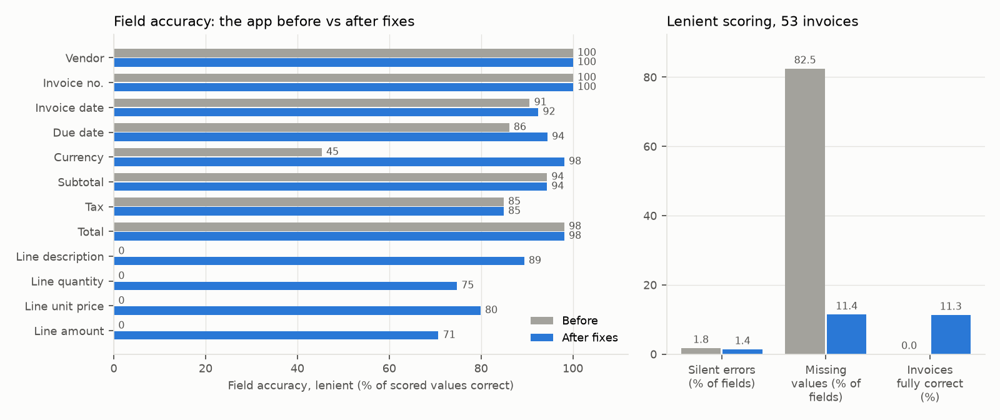

# 📄 Invoice Processing AI

> **Advanced invoice processing system powered by Google Document AI with a beautiful Streamlit frontend**

[](https://python.org)
[](https://fastapi.tiangolo.com)
[](https://streamlit.io)
[](https://cloud.google.com/document-ai)
[](https://docker.com)
[](LICENSE)

## 🎯 **Project Overview**

An end-to-end AI-powered invoice processing system that automates document processing for enterprises. Built for teams that spend hours keying invoices by hand.

> **Status, honestly:** this README used to claim "95%+ accuracy". An audit on 53 labeled invoices (2026-11-23) found the app as built got **0 of 53** invoices fully right: it never extracted a single line item. After the fixes it gets **6 of 53** fully right, and its new arithmetic checks send 49 of 53 to human review. Gemini 3.8 Flash with the same checks got **48 of 53**. The test set is mostly synthetic. Full numbers, method and limits: [audit report](audit/REPORT.md) ([2-page PDF](audit/REPORT.pdf)).

### 🌟 **Live Demo**


*Real-time invoice processing with AI-powered data extraction and confidence scoring*

### 💼 **Business Impact**

- ⚡ Turns an invoice into structured data (vendor, dates, totals, line items) in seconds instead of manual keying
- 🎯 Shows Document AI's per-field confidence, so low-confidence fields can be routed to review
- 🔄 Batch processing for multiple documents
- 📏 Accuracy: **measured**, see [Performance Metrics](#-performance-metrics) and the [audit report](audit/REPORT.md)

## 🏗️ **System Architecture**

```
┌─────────────────┐     ┌─────────────────┐     ┌─────────────────┐
│   File Upload   │────▶│  FastAPI Backend│────▶│ Google Document │
│   (Streamlit)   │     │   Validation    │     │      AI         │
└─────────────────┘     └─────────────────┘     └─────────────────┘
         │                       │                       │
         │                       ▼                       ▼
         │              ┌─────────────────┐     ┌─────────────────┐
         │              │   File Storage  │     │  Data Extraction│
         │              │   (Optional)    │     │  & Processing   │
         │              └─────────────────┘     └─────────────────┘
         │                       │                       │
         └───────────────────────┼───────────────────────┘
                                 ▼
                    ┌─────────────────────────────────────┐
                    │         Results Display             │
                    │   • Vendor Info  • Financial Data  │
                    │   • Line Items   • Confidence      │
                    │   • Analytics    • Export Options  │
                    └─────────────────────────────────────┘
```

## ✨ **Key Features**

### 🤖 **AI-Powered Processing**
- **Google Document AI Integration** - Enterprise-grade document understanding
- **Real-time Data Extraction** - Vendor info, amounts, dates, line items
- **Confidence Scoring** - Document AI's own per-field confidence, visualized (an estimate, not measured accuracy)
- **Multi-format Support** - PDF, PNG, JPG, JPEG, TIFF, GIF files
- **Intelligent Parsing** - Understands invoice structure, not just OCR

### ⚡ **Performance & Scale**
- **Fast Processing** - Typically a few seconds per document in development testing
- **Batch Processing** - Handle up to 10 documents simultaneously
- **Error Handling** - Validation and error handling around the Document AI call
- **Container Ready** - Docker setup included
- **Real-time Analytics** - Processing history and performance metrics

### 🎨 **Professional Interface**
- **Beautiful Streamlit Frontend** - Modern, responsive design
- **Drag & Drop Upload** - Intuitive file upload experience
- **Interactive Visualizations** - Plotly charts for confidence scoring
- **Real-time Feedback** - Progress indicators and status updates
- **Mobile Responsive** - Works perfectly on all devices

### 🔧 **Developer Experience**
- **Complete Documentation** - API docs, setup guides, deployment instructions
- **Docker Containerization** - One-command deployment
- **CI/CD Pipeline** - Automated testing and deployment
- **Open Source** - MIT license, fully customizable

## 🛠️ **Technology Stack**

### **Backend & AI**
- **FastAPI** - High-performance async web framework
- **Google Cloud Document AI** - Advanced document understanding
- **Python 3.8+** - Modern Python with type hints
- **Pydantic** - Data validation and serialization
- **Uvicorn** - Lightning-fast ASGI server

### **Frontend & Visualization**
- **Streamlit** - Rapid web app development
- **Plotly** - Interactive data visualization
- **Pandas** - Data processing and analysis
- **Custom CSS** - Professional styling and branding

### **Infrastructure & DevOps**
- **Docker & Docker Compose** - Containerization
- **GitHub Actions** - CI/CD automation
- **Nginx** - Production reverse proxy
- **Kubernetes** - Container orchestration (optional)
- **Helm Charts** - Package management

### **Optional Enhancements**
- **PostgreSQL** - Production database
- **Redis** - Caching and session management
- **Prometheus** - Monitoring and alerting
- **Google Cloud Storage** - File storage

## 🚀 **Quick Start**

### **Prerequisites**
- Python 3.8+
- Google Cloud Account with Document AI enabled
- Git
- Docker (optional)

### **1. Clone Repository**
```bash
git clone https://github.com/ypratap11/invoice-processing-ai.git
cd invoice-processing-ai
```

### **2. Install Dependencies**
```bash
pip install -r requirements.txt
```

### **3. Google Cloud Setup**
```bash
# Set up environment variables
cp .env.example .env

# Edit .env with your credentials:
# GCP_PROJECT_ID=your-project-id
# GCP_LOCATION=us
# GCP_PROCESSOR_ID=your-processor-id
# GOOGLE_APPLICATION_CREDENTIALS=path/to/your/key.json
```

### **4. Run Application**
```bash
# Terminal 1: Start API Backend
cd src/api
python main.py

# Terminal 2: Start Frontend
cd frontend
streamlit run app.py
```

### **5. Access Application**
- **Frontend**: http://localhost:8501
- **API Documentation**: http://localhost:8000/docs
- **Health Check**: http://localhost:8000

## 🐳 **Docker Deployment**

### **Development Setup**
```bash
docker-compose up --build
```

### **Production Deployment**
```bash
# Build production images
docker build -t invoice-ai-backend .
docker build -t invoice-ai-frontend .

# Deploy with production compose
docker-compose -f docker-compose.prod.yml up -d
```

## ☸️ **Kubernetes Deployment**

```bash
# Apply Kubernetes manifests
kubectl apply -f k8s/

# Or use Helm
helm install invoice-ai ./helm
```

## 📊 **Performance Metrics**

Measured on 53 labeled invoices (40 generated in 5 layouts with deliberate hard cases, 13 from a public synthetic dataset), runs dated 2026-11-23. *Lenient* = formatting cleaned up the same way for every system; *strict* = values exactly as the app returns them. A *silent error* is a wrong value that is not flagged for review.

| | App as built | App after fixes | Gemini 3.8 Flash + same checks |
|---|---|---|---|
| Invoices fully correct, lenient (strict) | 0 of 53 (0) | 6 of 53 (6) | 48 of 53 (48) |
| Line items returned | 0 of 471 | 472 for 471 printed | 471 of 471 |
| Values correct, lenient (strict), of 2,283 | 356 (158) | 1,864 (1,849) | 2,278 (2,278) |
| Silent errors, lenient (strict) | 40 (195) | 32 (40) | 2 (2) |
| Invoices sent to human review | 36 of 53 | 49 of 53 | 7 of 53 |
| Cost per invoice | $0.20 (Document AI called twice) | $0.10 | about $0.006 |
| Median time per invoice | 4.1 s | 4.1 s | 7.9 s |

What this means:
- After the fixes, header fields are right 388 of 407 times (95%) and line-item values 1,476 of 1,876 (79%).
- A 92% review rate is not a usable operating point. The checks stop most wrong values from passing silently, but by sending nearly every invoice to a person.
- Almost all remaining silent errors are on 4 scanned invoices where Document AI splits table rows into fragments.
- The test set is mostly synthetic and small. Treat the Gemini result as a reason for a real trial, not a verdict. A local-model comparison is deferred.



- Full report, findings and limits: [audit/REPORT.md](audit/REPORT.md) ([2-page PDF](audit/REPORT.pdf))
- Test set, scoring rules and how to rerun: [audit/README.md](audit/README.md)

## 📁 **Project Structure**

```
invoice-processing-ai/
├── 📂 src/
│   ├── 📂 api/                     # FastAPI backend
│   │   └── main.py                  # API entry point
│   └── 📂 utils/                   # Configuration & utilities
│       └── config.py               # Settings management
├── 📂 frontend/                    # Streamlit web interface
│   └── app.py                      # Main application
├── 📂 .github/                     # CI/CD & automation
│   ├── workflows/ci-cd.yml         # GitHub Actions
│   └── dependabot.yml              # Dependency updates
├── 📂 helm/                       # Kubernetes Helm charts
│   ├── Chart.yaml                  # Helm chart definition
│   └── values.yaml                 # Configuration values
├── 📂 k8s/                        # Kubernetes manifests
│   └── deployment.yml              # K8s deployment
├── 📂 monitoring/                  # Observability
│   └── prometheus.yml              # Monitoring config
├── 📂 tests/                      # Test suite
├── docker-compose.yml             # Multi-container setup
├── Dockerfile                     # Container definition
├── requirements.txt               # Python dependencies
├── .env.example                   # Environment template
├── nginx.conf                     # Reverse proxy config
└── README.md                      # This file
```

## 🎯 **Use Cases**

### **Enterprise Applications**
- **Accounts Payable Automation** - Streamline invoice processing workflows
- **Financial Data Entry** - Reduce manual keying, with low-confidence fields sent to review
- **Audit & Compliance** - Maintain accurate financial records
- **Accounting Integration** - Feed structured data into accounting systems

### **Business Benefits**
- **Time Savings** - Process invoices in seconds, not minutes
- **Review Focus** - Spend human time on low-confidence fields instead of every field
- **Scalability** - Handle volume spikes without additional staff
- **Compliance** - Standardized data extraction and audit trails

## 🧪 **Testing**

```bash
# Run test suite
pytest tests/ -v

# Run with coverage
pytest tests/ --cov=src/ --cov-report=html

# Test API endpoints
curl -X POST "http://localhost:8000/process-invoice" \
     -H "accept: application/json" \
     -H "Content-Type: multipart/form-data" \
     -F "file=@sample_invoice.pdf"
```

## 📈 **API Documentation**

The FastAPI backend provides interactive API documentation:
- **Swagger UI**: http://localhost:8000/docs
- **ReDoc**: http://localhost:8000/redoc

### **Key Endpoints**
- `POST /process-invoice` - Process single invoice
- `POST /batch-process` - Process multiple invoices
- `GET /config` - Get API configuration
- `GET /` - Health check

## 🔧 **Configuration**

### **Environment Variables**
```bash
# Google Cloud Configuration
GCP_PROJECT_ID=your-project-id
GCP_LOCATION=us
GCP_PROCESSOR_ID=your-processor-id
GOOGLE_APPLICATION_CREDENTIALS=path/to/credentials.json

# API Configuration
API_HOST=0.0.0.0
API_PORT=8000
DEBUG=true

# File Upload Configuration
MAX_FILE_SIZE=10485760  # 10MB
UPLOAD_DIR=uploads
```

## 🎨 **Screenshots**

### **Main Interface**
Beautiful, modern interface with drag-and-drop file upload and real-time processing feedback.

### **Processing Results**
Structured data extraction with confidence scoring and interactive visualizations.

### **Analytics Dashboard**
Processing history, success rates, and performance metrics.

## 🤝 **Contributing**

While this is primarily a portfolio project, contributions and feedback are welcome!

1. **Fork the repository**
2. **Create a feature branch** (`git checkout -b feature/amazing-feature`)
3. **Commit your changes** (`git commit -m 'Add amazing feature'`)
4. **Push to the branch** (`git push origin feature/amazing-feature`)
5. **Open a Pull Request**

## 📄 **License**

This project is licensed under the MIT License - see the [LICENSE](LICENSE) file for details.

## 🏆 **Portfolio Highlights**

This project demonstrates:

### **Technical Excellence**
- **Full-Stack AI Development** - End-to-end solution from ML to production
- **Cloud AI Integration** - Professional use of Google Document AI
- **Modern Architecture** - FastAPI + Streamlit + Docker
- **Production Readiness** - CI/CD, monitoring, containerization

### **Business Acumen**
- **Real Problem Solving** - Addresses actual enterprise pain points
- **Quantifiable Impact** - Measurable time and cost savings
- **Scalable Solution** - Enterprise-ready architecture
- **User Experience** - Beautiful, intuitive interface

### **Engineering Best Practices**
- **Clean Code** - Well-structured, documented, testable
- **DevOps Integration** - Complete CI/CD pipeline
- **Container Strategy** - Docker and Kubernetes ready
- **Open Source** - MIT license, community-friendly

## 👨‍💻 **About the Developer**

**Pratap Yeragudipati** - Founder, Augaster. I build AI systems whose outputs can be checked.

- 💼 **LinkedIn**: [Connect with me](https://www.linkedin.com/in/pratapyeragudipati/)
- 📧 **Email**: ypratap114u@gmail.com
- 🌐 **GitHub**: [View more projects](https://github.com/ypratap11)
- 💻 **Portfolio**: [Live Projects](https://github.com/ypratap11?tab=repositories)

### **Background**
20+ years in finance systems and program delivery, where numbers have to reconcile. This project combines that domain knowledge with modern document AI.

## 🌟 **What's Next?**

### **Immediate Roadmap**
- [x] **Accuracy Audit** - Labeled test set, measured field-level accuracy, published method ([report](audit/REPORT.md))
- [x] **Real Agent Tool** - The chat agent's `process_invoice` tool now runs the real extraction (it used to return sample data)
- [x] **Arithmetic Checks** - Line items + tax must equal the total, or the invoice goes to review
- [ ] **Better Line Extraction** - Bring the review rate down from 49 of 53 (scanned invoices fragment line rows)
- [ ] **Database Integration** - PostgreSQL for processing history
- [ ] **User Authentication** - Secure multi-user support
- [ ] **Advanced Analytics** - Deeper processing insights
- [ ] **API Rate Limiting** - Production-grade API protection

### **Future Enhancements**
- [ ] **Multi-language Support** - Process invoices in various languages
- [ ] **Custom Model Training** - Fine-tune AI with user feedback
- [ ] **Accounting Integrations** - Direct integration with QuickBooks and Xero
- [ ] **Advanced Document Types** - Purchase orders, receipts, contracts

---

## 💝 **Support This Project**

If you find this project helpful:
- ⭐ **Star this repository**
- 🔗 **Share on LinkedIn**
- 🐛 **Report issues**
- 💡 **Suggest improvements**
- 🤝 **Connect for collaboration**

---

**Built with ❤️ and AI | Transforming Business Processes Through Technology**

*This project showcases the power of combining domain expertise with modern AI to solve real-world business problems.*
