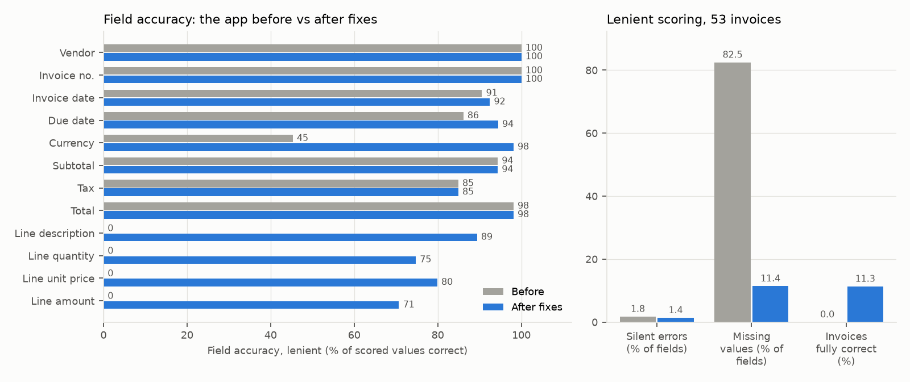
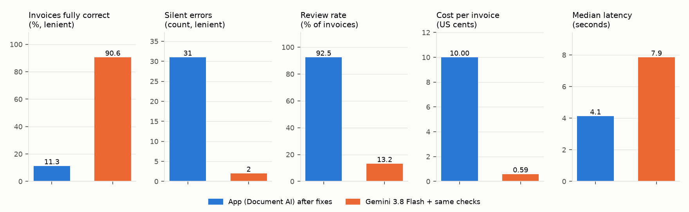

# Invoice accuracy audit

**Subject:** this repository's invoice extraction app (FastAPI + Google Document AI Invoice Parser).
**Runs:** 2026-11-23. **Author:** Pratap Yeragudipati, Augaster.
**Test set:** 53 labeled invoices. **Scoring rules:** frozen at git tag `audit-scoring-frozen` before the first measured run.

Every number below comes from the committed files in `audit/results/`. A two-page PDF version is
[`REPORT.pdf`](REPORT.pdf). How to rerun the audit: [`audit/README.md`](README.md).

## Summary

| | Claimed (old README) | App as built | App after fixes | Gemini 3.8 Flash + same checks |
|---|---|---|---|---|
| Invoices fully correct (lenient) | "95%+ accuracy" | **0 of 53** | **6 of 53** (11%) | **48 of 53** (91%) |
| Line items returned | | **0 of 471** | 472 for 471 printed | 471 of 471 |
| Values correct (lenient) | | 356 of 2,283 (16%) | 1,864 of 2,283 (82%) | 2,278 of 2,283 (99.8%) |
| Values missing | | 1,883 | 261 | 3 |
| Wrong values passed on silently (lenient) | "Zero data entry errors" | 40 | 31 | 2 |
| Invoices sent to human review | | 36 of 53 | 49 of 53 | 7 of 53 |
| Cost per invoice | | $0.20 (Document AI called twice per upload) | $0.10 | about $0.006 |

Before the fixes the silent-error count looks small only because 82% of values were not returned at all.
A blank is visible, so it is not counted as silent.

The short version:

- The app never extracted a single line item. Document AI found the line items, but the app looked for them
  in the wrong place and dropped them, on all 53 invoices.
- After the fixes, header fields (vendor, invoice number, dates, currency, totals) are right 388 times out of
  407 (95%). Line-item values are right 1,476 times out of 1,876 (79%). Only 6 of 53 invoices come out
  fully right.
- The new arithmetic checks catch most of the remaining errors, but they do it by sending 49 of 53 invoices
  to a person. That is a safety net, not automation.
- Gemini 3.8 Flash, given the same documents and the same checks, got 48 of 53 invoices fully right at about
  6% of the per-invoice price. The test set is mostly synthetic, so read that as "worth a real trial", not as
  a verdict.

## 1. What was claimed

Until commit `9fb82e6` (2026-11-23) the README said, among other things:

> "this system reduces processing time by **90%** and achieves **95%+ accuracy**"
>
> "**Zero data entry errors** with automated validation"
>
> "**100% Success Rate** - Robust error handling and validation"
>
> Performance table: "Accuracy | 95%+ | ✅ Achieved" and "Success Rate | 100% | ✅ Perfect"

The Streamlit app also said "**Reliability**: 99.9% uptime SLA".

None of these figures had a measurement behind them. This audit tests the accuracy claims. It does not test
the time saving (90%) or uptime (99.9%) claims. There is no evidence for or against them in the repo, and they
have been removed. On "100% success rate": the Document AI call did succeed on all 53 invoices (0 errors).
But a call that succeeds is not a result that is correct, which is what the rest of this report is about.

## 2. Test set

53 invoices, each with a hand-checked truth file (`audit/testset/`; list in `manifest.csv`, sources and
licences in `SOURCES.md`).

**40 generated invoices** (`gen-001` to `gen-040`), rendered from JSON truth in 5 visibly different
layouts (8 each). The hard cases are deliberate, and one invoice can have several:

| Hard case | Invoices |
|---|---|
| Day-first dates (09-07-2026 = 9 July) | 17 |
| Non-USD currency (EUR, GBP, INR) | 11 |
| Discount as a negative line | 10 |
| Scanned look (rasterised, tilted, blurred, noisy PNG) | 10 |
| Several tax lines | 7 |
| Two pages, line items across both | 6 |
| Decimal comma (1.234,56) | 4 |
| Printed total that is wrong (the invoice itself is wrong) | 4 |

**13 public invoices** (`pub-001` to `pub-013`) from the Hugging Face dataset
[katanaml-org/invoices-donut-data-v1](https://huggingface.co/datasets/katanaml-org/invoices-donut-data-v1)
(MIT licence). Its images come from Kozłowski, M., & Weichbroth, P. (2021), *Samples of electronic invoices*
(Version 2), Mendeley Data, [doi:10.17632/tnj49gpmtz.2](https://doi.org/10.17632/tnj49gpmtz.2), CC BY 4.0.
Every label was checked by eye against the image; 9 labels were corrected (listed in `SOURCES.md`).

Caveats about the test set:

- **Almost all of it is synthetic.** I generated the 40. The 13 public ones are also machine-generated, from
  a single template with invented names. They add a third-party layout, not real scans. No real supplier
  invoice is in the set.
- **Public line amounts are net.** The public invoices print both a net (pre-tax) and a gross value per line.
  The truth uses the net value, because the net values add up to the subtotal. A system that returns the
  gross value is scored wrong.
- **Layout 5 has an untagged trap.** It looks European (amounts with a currency-code suffix) but prints dates
  US-style, month first. Those 8 invoices are not tagged as a date hard case.
- **Not every day-first date is hard.** 3 of the 17 day-first invoices (layout 2) print the month as a word,
  so there is nothing to guess.

## 3. Method

**System under test.** The Streamlit front end posts to `POST /process-invoice` in `src/api/main.py`. That
path is "the app as built". The "before" runner calls the same Document AI processor and runs the app's
original extraction code unchanged (frozen copy in `audit/runners/docai_legacy.py`). Its adapter only renames
keys. Processor: Invoice Parser `pretrained-invoice-v2.0-2023-12-06` ("Google Stable"), region `us`.
Each document was sent to Document AI once and the raw response cached. The "after" run re-reads the same
cached responses, so **the before/after difference is entirely the app's own code.**

**Fields scored.** Vendor, invoice number, invoice date, due date, currency, subtotal, tax total, total, and
for each line item: description, quantity, unit price, amount. A field whose truth is empty (for example no
due date printed) is not scored. That gives 2,283 scored values: 407 header values and 1,876 line-item values
over 471 printed lines.

**Two scores.**
- *Strict*: the value exactly as the app hands it to its user. "21,380.24" for 21380.24 is wrong, "$" for USD
  is wrong, "06/10/2026" for 2026-06-10 is wrong. This is what a downstream system receives.
- *Lenient*: after one shared clean-up, identical for every system. Thousands separators and currency
  symbols or codes are stripped from amounts, including codes glued to the number ("USD12.00", "12.00EUR");
  brackets or a trailing minus mean negative. Letters glued in front of a number are stripped too, so an
  identifier like "INV1234" in an amount field reads as 1234 (a hyphenated "INV-1234" is rejected). Any date
  format is accepted, but a numeric date is always read **month first**, for every system: "05/06/2026" is
  read as 6 May, so a day-first truth printed that way scores wrong for whoever returns it as printed. Only a
  date missing its day, month or year (or not a date at all) is rejected. Invoice numbers are compared ignoring case and spaces.
  Currency is upper-cased, but a symbol like "$" is still wrong.

**Rules** (from `audit/scorer.py` and `audit/normalize.py`, as frozen):
- Amounts, quantities and unit prices: equal to the cent after rounding half-up. Quantities are compared to
  the cent too, so 2.004 counts as 2.
- Dates: equal as calendar dates. Strict accepts only `YYYY-MM-DD`.
- Vendor: strict means the same text ignoring case and spacing; lenient means fuzzy `token_set_ratio` of at
  least 90.
- Line description (both modes): fuzzy `token_set_ratio` of at least 85.
- Line items: each printed line is paired with at most one extracted line by best overall description match
  (Hungarian assignment; a pair below 60 similarity counts as unmatched). An unmatched printed line is
  *missing*. An extracted line with no partner is an *extra line*.
- An invoice is *fully correct* only if every scored value is correct and there are no extra lines.

**Silent error, the key metric:** a value that is *wrong* (present, but not equal to the truth) and *not
flagged* for review. A missing value is never silent, because a blank is visible. What counts as a flag:
- *Before*: the app's only flag, Document AI confidence below 0.7 on that field.
- *After*: any deterministic check failing (the whole invoice goes to review), plus the confidence flag.
  A line item's fields inherit the line's own confidence.
- *Gemini* gives no calibrated confidence. Without checks every error is silent; with checks, it gets the
  same checks as the app.

**The checks** (`src/core/invoice_checks.py`): quantity × unit price = line amount; line amounts add up to the
subtotal; subtotal + tax = total (all within 1 cent); dates are valid and the due date is not before the
invoice date; vendor, invoice number, invoice date and total are present. Amounts are read with any currency
symbol or code removed ("$", "€", "₹", "Rs.", "INR"); an amount that is present but still cannot be read as a
number is itself a reason for review (`unparseable_amount:<field>`), so a check is never skipped silently.

**Gemini.** Model `gemini-3.8-flash` on Vertex AI, endpoint `global`, temperature 0, the document sent as
file bytes with a JSON schema for the output. The prompt, verbatim (`PROMPT` in `audit/runners/gemini.py`):

```text
You are extracting data from an invoice document. Return one JSON object matching the response schema.

Rules:
- Dates: ISO format YYYY-MM-DD.
- Numbers (subtotal, tax_total, total, quantity, unit_price, amount): plain decimal numbers as strings, no currency symbols, no thousands separators, '.' as the decimal mark (e.g. "1234.50").
- currency: the ISO 4217 code (e.g. "USD", "EUR", "GBP").
- Discounts and credits: output them as separate line items with a negative amount.
- vendor_name, invoice_id and line item descriptions: copy exactly as printed.
- tax_total is the total tax amount; total is the final amount due/payable.
- Use null for any value that is not present on the document. Do not guess or compute missing values.
- List every line item in document order.
```

**Method caveats.**
- `token_set_ratio` scores 100 when one text's words are a subset of the other's, so "Acme" would match
  "Acme Industrial Supplies Ltd". This makes lenient vendor and line description scores generous.
- In the "before" path line items carried no confidence flag at all, so a wrong line value could never have
  been flagged. (The app returned no line items, so this did not change any number here.)
- The original app mapped table columns to fields by keywords in the header text, checked in order. A
  column headed "Item Total" would map to description, and "Tax Rate" to unit price. This did not matter here,
  because Document AI returned no tables, but it would on other documents.
- Comparing systems is fairest in lenient mode. Gemini was told to output ISO dates and plain numbers; the app
  returns whatever text Document AI read. Strict numbers penalise the app for format.

## 4. Findings

### Finding 1: the chat agent's "process invoice" tool returned made-up data
`src/agents/tools.py` returned a hard-coded sample invoice ("Acme Corporation", $1,250.00, two lines) for any
file, marked with a TODO, and **saved it to the database** as if it had been processed. The chat agent never
called Document AI. Anyone using the chat feature got fiction that looked like a result.

### Finding 2: line items were never extracted, on 53 of 53 invoices
The app built line items only from tables that Document AI detected, keyed by the table's header text. On
these 53 invoices Document AI returned **0 tables**. It did return **472 `line_item` entities**, with
description, quantity, unit price and amount, but the app ignored that entity type. Result: 0 of 471 printed
line items reached the user, on every invoice, with no error and no flag.

The same code kept one value per field type, so a later value overwrote an earlier one. On the 7 invoices with
several tax lines it reported a single tax line as the tax total. Example: gen-003 prints taxes adding up to
4,662.55; the app said 1,019.93.

### Finding 3: two extraction implementations, one of them dead
`src/core/document_processor.py` was a second extractor with a different overwrite bug. Nothing called it
except its own self-test. Two diverging copies of the same job is how fixes end up in the wrong place.

### Finding 4: every upload paid Document AI twice
`POST /process-invoice` called the Document AI processing function twice in a row for each upload and used
the second result. At $0.10 per document, the app paid $0.20 per invoice for one result.

### Security findings, fixed during the audit
- **The agent tool could be steered into reading files it should not.** Once the tool was connected to real
  extraction (the fix for finding 1), an automated security review found that it would open whatever file
  path the language model gave it and send the contents to Document AI. A crafted chat message could have made
  the server read its own files. This was fixed in the same change set, before the work was merged: the tool
  now only opens ordinary files inside the configured upload folder, refuses links that point elsewhere, and
  enforces the size limit. A final review found one more path form that reached the filesystem before the
  folder check; paths are now checked by their text alone before any file lookup.
- **Error messages revealed where the cloud credentials file lives.** When credentials were missing, the
  error returned to the caller included the credentials file path. Errors are now generic; details go to the
  server log only.

### Failure categories, measured

Counts are values out of the scored totals, lenient unless marked strict. One example each.

**App as built (before):**

| Category | Count | Example |
|---|---|---|
| Line items not returned | all 1,876 line values, 53 of 53 invoices | gen-001: 40 printed lines, 0 returned |
| Amounts in display format (strict) | subtotal 49, total 51, tax 36 of 53 | gen-001 subtotal "21,380.24" |
| Dates not in ISO format (strict) | invoice date 47 of 53, due date 31 of 36 | gen-001 "06/10/2026" for 2026-06-10 |
| Currency as a symbol, not a code | 28 of 53 | gen-001 "$" for USD |
| Day-first date left ambiguous or misread | invoice date 4, due date 5 | gen-018 "09-07-2026" (9 July) |
| Several tax lines, one reported | 7 of 53 | gen-003: 1,019.93 for 4,662.55 |
| Header value not found | 7 values on 5 invoices | gen-039: no subtotal, tax or total |

Silent errors: 40 lenient, 195 strict (strict counts formatting as wrong). 36 of 53 invoices had at least one
low-confidence flag.

**App after fixes:**

| Category | Count | Example |
|---|---|---|
| Line value wrong (rows out of step, misreads) | quantity 49, unit price 22, amount 72, description 3 | gen-024 quantity "5050" for 50 |
| Printed line with no extracted partner | 47 lines | gen-002 "Flat washer - M6" |
| Extra extracted lines (row fragments) | 48 lines on 13 invoices | gen-020: 15 lines extracted for 8 printed |
| Several tax lines, one reported | 7 of 53 | gen-003, as above |
| Day and month swapped | invoice date 3, due date 2 | gen-026 2026-10-02 for 2026-02-10 |
| Header value not found | 7 values on 5 invoices | gen-024 currency (INR) not returned |
| "Rs." amounts passed through as printed (strict) | 10 values on 1 invoice (all flagged) | gen-024 total "Rs.32,304.78" |

In total 261 values were missing after the fixes (254 line values, 7 header values).

**Gemini 3.8 Flash:**

| Category | Count | Example |
|---|---|---|
| Month-first date read day-first | 2 of 53 invoice dates, both public invoices | pub-004 2014-01-10 for 2014-10-01 |
| Tax total left empty on several-tax invoices | 3 of 7 such invoices | gen-013 tax total null |

## 5. Fixes

Made in commits `9a04d1d` and `50bbf66`, with tests in `tests/core/`:

1. **One extractor** (`src/core/invoice_extractor.py`) that reads Document AI's `line_item` entities and
   their parts, using Document AI's normalised values (ISO dates, plain numbers, currency codes) instead of
   the printed text. For a repeated header field it keeps the most confident value. The dead
   `document_processor.py` was removed.
2. **Deterministic checks** (`src/core/invoice_checks.py`, listed in section 3). The API response now
   carries `review_required` and `review_reasons`.
3. **One Document AI call per upload.**
4. **The agent tool runs the real extraction**, confined to the upload folder, with generic error messages.

Not fixed: the several-tax-lines case (7 invoices). The extractor still reports one tax line, but the total
check catches all 7 and sends them to review.

## 6. Before and after (Document AI, same responses)



| Lenient (strict in brackets) | Before | After |
|---|---|---|
| Invoices fully correct | 0 of 53 (0) | 6 of 53 (6) |
| Header values correct | 356 of 407 (158) | 388 of 407 (385) |
| Line values correct | 0 of 1,876 (0) | 1,476 of 1,876 (1,464) |
| Values missing | 1,883 (1,883) | 261 (261) |
| Silent errors | 40 (195) | 31 (31) |
| Invoices sent to review | 36 of 53 | 49 of 53 |

Per-field accuracy is in the chart and in `aggregate_lenient.field_accuracy` in each results file.
The "after" results were re-scored on 2026-11-24 from the same cached responses, after a fix to how the checks
read "Rs." amounts (below); no API calls were made and only the review flags changed.

### The review rate, read honestly

The silent-error count after the fixes depends on what is allowed to send an invoice to review. Two views of
the app after fixes:

| What can flag an invoice | Sent to review | Silent errors, lenient | Silent errors, strict |
|---|---|---|---|
| (a) Checks only | 43 of 53 (81.1%) | 31 | 31 |
| (b) Checks + Document AI confidence below 0.7 | 49 of 53 (92.5%) | 31 | 31 |

View (a) was computed by re-scoring the committed predictions with the frozen scorer and the confidence flags
removed. No API calls were made.

**A review rate of 92.5% is not a usable operating point.** If 49 of every 53 invoices go to a person, the app
saves very little keying; it is mostly a pre-filled form. What the checks show is narrower but real: on this
test set they stop most wrong values from passing silently, and they caught all 4 invoices whose own printed
total is wrong. The way to a lower review rate is better line extraction, not looser checks. Confidence
flags add 6 invoices to review but remove no silent errors in either mode.

**Where the remaining silent errors are.** All 31 silent errors (lenient and strict alike) are on 4 scanned
invoices (gen-008, gen-010, gen-020, gen-036). On these, Document AI splits a printed row into fragments: the
description lands on one extracted line, the quantity on another, the price on a third. Values shift between
rows, yet the line amounts still add up to the subtotal, and every row that has all three numbers is
internally consistent. So no check fires. gen-024, a digital PDF, has one quantity read as "5050" for 50; the
quantity × unit price check catches it and sends the invoice to review. (A first version of the checks could
not read its "Rs." amounts and skipped every check on that invoice without saying so; the checks now strip the
"Rs." prefix and report any amount they cannot read.) Its "Rs." amounts are still wrong in strict mode, but
flagged.

## 7. Model comparison



Lenient numbers lead, because Gemini was told to output clean formats and the app was not (section 3).

| | App after fixes (Document AI) | Gemini 3.8 Flash + same checks |
|---|---|---|
| Model / version | Invoice Parser `pretrained-invoice-v2.0-2023-12-06` | `gemini-3.8-flash`, Vertex AI `global` |
| Invoices fully correct | 6 of 53 (strict 6) | 48 of 53 (strict 48) |
| Values correct | 1,864 of 2,283 (strict 1,849) | 2,278 of 2,283 (strict 2,278) |
| Silent errors | 31 (strict 31) | 2 (strict 2) |
| Sent to review | 49 of 53 | 7 of 53 |
| Cost for 53 invoices | $5.30 | $0.314 |
| Cost per invoice | $0.10 | about $0.006 |
| Median time per invoice | 4.1 s | 7.9 s |

Of Gemini's 7 reviews, 4 are the invoices whose printed total really is wrong, and 3 are invoices where it
left the tax total empty. Its 2 silent errors are both day/month swaps on public invoices that print US-style
dates. Without the checks Gemini flags nothing, and the 4 wrong-total invoices would pass as if they were fine.

**A local-model comparison is deferred.** It was planned (a small model running on a laptop) but was not run
in this round.

**Cost notes.**
- Document AI Invoice Parser: $0.10 per document of up to 10 pages (Google pricing page, checked 2026-11-23).
  53 documents cost $5.30. Before the fix, the upload endpoint would have paid $0.20 per invoice.
- Gemini: actual token usage, priced at $0.75 per million input tokens and $3.75 per million output tokens
  (thinking tokens included). These are the `global` endpoint prices on the Vertex AI pricing page (checked
  2026-11-24); the Gemini Developer API pricing page lists the same figures. They are introductory prices
  valid through 2026-12-31. From 2027-01-01 Google lists $1.50 and $7.50, which would double the cost to
  about $0.012 per invoice. Regional (non-global) endpoints are listed about 10% higher.
- The spend ledger charged a conservative pre-call estimate for Gemini ($1.75 rather than the $0.31 actually
  used), so it shows $7.09 for all runs and tests. All of it was covered by Google Cloud free-trial credit.
- **Data residency.** The `us-central1` endpoint returned "not found" for Gemini models in this project, so
  the runs used the `global` endpoint, which does not pin where a request is processed. A client with data
  residency requirements would need a regional endpoint.

## 8. Limits

- **Mostly synthetic data.** I generated 40 of the 53 invoices, and the other 13 are synthetic too. There are
  no real supplier invoices, no handwriting and no phone photos. Real-world accuracy could be lower for every
  system here.
- **Small sample.** 53 invoices. A difference of one or two invoices is noise. The large gaps (0, 6 and 48
  fully correct) are not.
- **One version of each system, on one day:** Invoice Parser `pretrained-invoice-v2.0-2023-12-06` and
  `gemini-3.8-flash`, runs dated 2026-11-23. Both vendors change their models.
- **One prompt, one run.** Gemini ran once per invoice at temperature 0 with the prompt above. Prompt tuning
  was not tried and run-to-run variation was not measured.
- **The same person wrote the fixes and the test set.** To limit that bias, the scoring rules were frozen
  before the first measured run and the test set was not changed after seeing results.
- **Latency** is from a laptop on a home connection, one request at a time. The "after" run re-used cached
  responses, so its latency is the "before" network time.
- **Open items, not fixed in this round:** a failed extraction is reported with `review_required` set to false;
  nothing in the app yet saves uploads to the folder the agent tool reads from; a few agent endpoints still
  return raw exception text.

## 9. Changes after the scoring freeze

None. `git diff --stat audit-scoring-frozen HEAD -- audit/scorer.py audit/normalize.py` is empty. The scoring
and normalising rules behind every number here are the ones tagged before the first measured run (tag
`audit-scoring-frozen`, commit `33b780c`).
